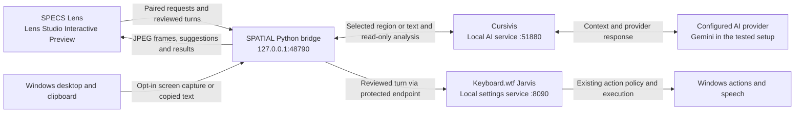

# Spatial architecture

## Runtime at a glance

The ports shown are defaults. The Lens and bridge run on the same Windows machine for Preview. The two optional Windows apps own their own credentials and setup. A physical SPECS device would need a separately verified secure transport.

## Ownership

The new Lens owns world placement, navigation, display and status. A separate Windows companion owns capture, consent and request routing. Keyboard.wtf owns Jarvis conversation, speech playback, local actions and confirmation. Cursivis owns analysis, provider selection and its existing desktop triggers. Its trigger socket opens the desktop workflow, while its local /suggest-actions and /analyze endpoints are suitable for the AR workflow. The older Keyboard.wtf serves as a historical UX reference. No existing application is bundled here.

## Feasibility and gates

| Path | Preview strategy | Device strategy and limits |
|---|---|---|
| Windows display | One JPEG sampled from the active sharing region at a time. Test InternetModule against a local bridge first and bind the decoded texture to a world-space display. Start with 960 pixels wide and tune from measured latency. | Use a paired secure transport. Experimental insecure transport is confined to local development. Validate additive contrast and frame latency on hardware. |
| Voice | Pinch the orb, listen through SPECS ASR where Preview supports it, and send only the final transcript. Provide an explicitly labeled typed turn through the Windows companion. | Hold microphone capture only during the active turn. Use ASR and separate confirmation. Keyboard.wtf speaks on Windows in the initial integration. |
| Context | Explicitly copy selected text in Windows, then pinch Cursivis. With no fresh text, the Lens freezes its displayed frame and accepts a pinch drag over the mirror. The companion crops the matching in-memory JPEG and sends only the selected pixels to the installed Cursivis backend for ranking and analysis. The mirror resumes live updates alongside the result. | The selection surface is confined to the Lens and leaves Windows pointer control alone. The bridge keeps at most four encoded frames with a 60-second crop window. |

Source references are the [Devpost requirements](https://learn-specs.devpost.com/rules), [SPECS Preview guide](https://developers.snap.com/spectacles/get-started/start-building/preview-panel), [Internet Access](https://developers.snap.com/spectacles/about-spectacles-features/apis/internet-access), and [ASR Module](https://developers.snap.com/spectacles/about-spectacles-features/apis/asr-module).

## Gesture contract

Use a one-hand Interaction Kit ray and pinch. Hover highlights the target and shows a cursor. Each pinch is captured by one target until release or cancel. No empty-space gesture issues Windows actions.

| Surface | Gesture | Transition |
|---|---|---|
| Top rail | Pinch and drag | Idle → Move → Idle. Keep the new world transform on release. |
| Size controls | Pinch plus or minus | Change the width by one increment within roughly 48–79 cm, preserving aspect ratio. |
| Shared pixels | Aim | Map the ray hit to UV within the active image rectangle, excluding letterboxing. In the Preview fallback, use the physical PC pointer to select. |
| Cursivis chip | Pinch | Idle → Capture → Suggestions for fresh copied text. Without fresh text, enter Snip mode. |
| Mirrored desktop in Snip mode | Pinch, drag, release | Freeze → Outline → Crop → Suggestions. A released rectangle captures only the selected region. A cancelled pinch clears the outline. The close control exits Snip mode. |
| Suggestion tile | Aim and pinch | Context → Analyzing → Result. Only an advertised read-only action can run against that revision. |
| Jarvis orb | Pinch | Idle → Listening → Review transcript → Submitted. A separate Confirm pinch admits one turn. Windows retains its existing action-level confirmation. |
| Settings | Pinch | Idle → Settings. Show connection, stream and consent state. Provider settings remain in the owning applications. |
| Close or cancel | Pinch | Clear transient text and transcript, stop listening, and return to Idle. Exit stops polling and drops session state. |

Place the panel about 1.2 m away, slightly below eye height. Anchor to the room at initial placement. Use a bright cyan edge and high-contrast typography with a minimum target size of 5 cm. Keep the orb and suggestions beside the content. Let result cards close independently.

## Transport and trust

Bind the companion to loopback for Preview. Keep the pairing credential out of Git and require it on private routes. Capture is opt-in, frames are transient and the app never uploads a desktop recording. An independent local control can pause all requests. Cross-origin browser traffic is denied. For a physical device, add a TLS endpoint with an explicit trust and pairing setup before enabling any control.

The bridge relays only explicit Jarvis turns to the local protected endpoint. A successful upstream submission means the command was accepted. Demonstrate completion with the resulting Windows state. Selection actions use an expiring snapshot and a fixed read-only allowlist. Exclude provider keys, account data, arbitrary URLs, shell execution and browser writes from the bridge.
